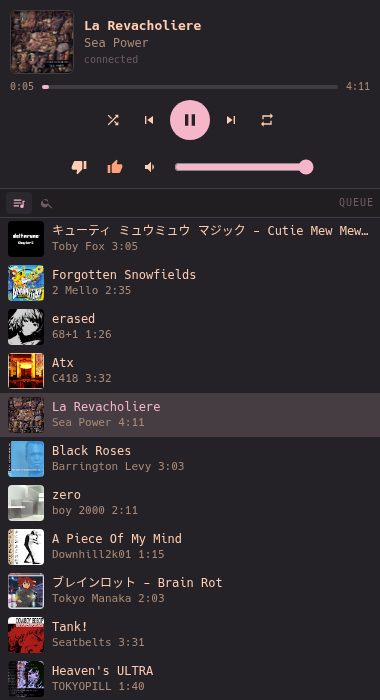
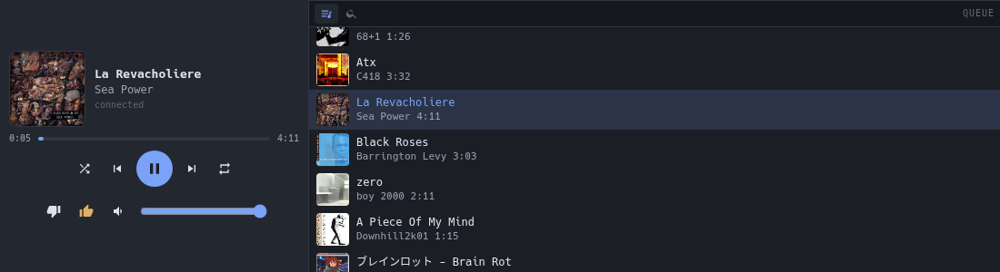
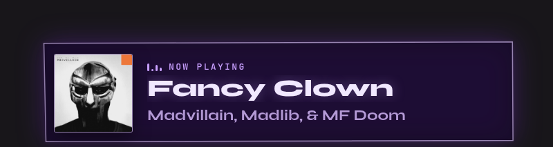

<div align="center">

# obs-pear-remote

**Control Pear Desktop from an OBS dock, and put what's playing on stream.**<br>
Two HTML files. No build, no plugin, nothing to install but Python.

[](#quick-start)
[](https://github.com/pear-devs/pear-desktop)
[](#quick-start)
[](LICENSE)




</div>

> Unofficial, vibecoded, and not affiliated with Pear Desktop, YouTube or Google.
> [The fine print.](#the-fine-print)

## What you get

**Pear Remote** (`pear-remote.html`, a custom browser dock): play/pause, previous/next, seek,
volume and mute, like/dislike, shuffle and repeat. It shows the live queue (click a song to jump to
it, ✕ to remove it) and has a search box whose results you can play now, play next or add to the
end. With an optional [Pear patch](#mixed-for-you-optional-pear-patch), a third tab lists your
personal *Mixed for you* shelf (My Supermix, Discover Mix, My Mix 01…) and plays those too. A
[Radio](#radio) tab plays internet radio stations, a [Podcasts](#podcasts) tab plays podcast
episodes and remembers where you stopped, a [YouTube](#youtube) tab lists your YouTube
home page and controls the video in your browser, and a [Twitch](#twitch) tab lists the channels
you follow that are live. When
the dock is at least 560 px wide and 4:3 or wider, it switches to a side-by-side layout.

**Now Playing** (`now-playing.html`, a browser source): cover, title and artist. Long titles
scroll, the card dims while paused and hides itself when nothing is playing. On Linux it can also
show the YouTube video playing in your browser ("Now watching") while Pear is idle or paused.

<div align="center">

</div>

## Quick start

**1. In Pear**, open **Plugins** and enable **API Server** (keep port `26538` and *Authorize at
first request*) and **Amuse**.

**2. Serve the files** on loopback, and leave the server running while you stream:

```sh
git clone https://github.com/cybWasHere/obs-pear-remote
python3 obs-pear-remote/extras/serve.py 9870 --bind 127.0.0.1 --directory obs-pear-remote
```

On Windows, double-click `extras\start-server.cmd` instead; closing its window stops the server.

**3. In OBS**, add them:

| | where | URL |
|---|---|---|
| Remote | *Docks › Custom Browser Docks…* | `http://127.0.0.1:9870/pear-remote.html` |
| Card | *Browser* source, 800 × 300 | `http://127.0.0.1:9870/now-playing.html` |

The first time the dock connects, Pear asks whether to allow `obs-pear-remote`. Click **Allow**;
Pear remembers it. The card's background is already transparent.

<details>
<summary><b>Requirements</b></summary>
<br>

- **Pear Desktop**, tested with 3.12.0.
- **OBS Studio 30 or newer**, tested with 32.2.2 on Linux and 32.2.1 on Windows 11. Custom browser
  docks need the browser plugin, which the official builds include.
- **Python 3**, only to serve the files. On Windows, install it from python.org (that adds the `py`
  launcher).

No git? *Code › Download ZIP* on GitHub works just as well.

</details>

<details>
<summary><b>Other ways to serve, and starting at login</b></summary>
<br>

`extras/serve.py` is Python's `http.server` plus a few endpoints: `/mpris.json`, which the card uses
for the browser-video fallback (Linux only), the ones behind the remote's Radio, Podcasts and
YouTube tabs, and `/now.json` (what the radio or the podcast is on, with `POST /now` to pause it),
for a desktop widget of your own. Without those, the stock server does the rest:

```sh
python3 -m http.server 9870 --bind 127.0.0.1 --directory obs-pear-remote          # Linux / macOS
py -m http.server 9870 --bind 127.0.0.1 --directory C:\path\to\obs-pear-remote    # Windows
```

**At login:**

- **Linux**: `extras/obs-pear-remote.service` is a systemd user unit that runs `serve.py`. Copy it
  to `~/.config/systemd/user/` (if you cloned somewhere other than `~/obs-pear-remote`, fix both
  paths on its `ExecStart` line), then
  `systemctl --user enable --now obs-pear-remote`.
- **Windows**: put a shortcut to `extras\start-server.cmd` in the Startup folder (Win+R,
  `shell:startup`) and set the shortcut to *Run: Minimized*.

</details>

## Good to know

- **Keep `--bind 127.0.0.1`.** The API server controls your playback, so the page holding its token
  should only be reachable from your own machine. Serving over `http://` rather than opening the
  files as `file://` also avoids the cross-origin and local-network restrictions of OBS's browser.
- **Amuse does double duty.** The card reads everything from Amuse, and the browser's video from
  `serve.py`'s `/mpris.json`; the remote uses Amuse only as a fallback for the current song until
  Pear sends its first player event.
- **The dock reloads itself** whenever `pear-remote.html` changes on disk, since docks have no
  reload button. `?reload=0` turns that off.
- **Search lists songs and videos only.** They are recognised by what their play button starts, so
  YouTube Music's language doesn't matter.
- **Pear 3.12.0 has two gaps.** It doesn't report repeat, mute or volume changes over its
  websocket, so those buttons work but never light up. And while a mix or radio plays, adding to
  the queue silently does nothing: Pear sends YouTube the current queue's context, and YouTube then
  returns no songs. The [Pear patch](#mixed-for-you-optional-pear-patch) fixes that as well.

## Radio

The Radio tab lists the stations in `radios.json`: the main French ones (franceinfo, France Inter,
BFM, RTL, TSF Jazz, FIP and its webradios…) and a handful of internet stations worth knowing (Radio
Meuh, NTS, LYL, Kiosk, dublab, WFMU, Nightwave Plaza, SomaFM…). Click one to play it, click it again
(or the big button) to stop.

Pear can't play a stream, so `extras/serve.py` does, through [mpv](https://mpv.io): the tab needs
`serve.py` as the server (not plain `http.server`) and `mpv` on the `PATH`. Tested on Linux.

- While a station is on, the player shows it: the track title when the station sends one,
  previous / next step through the stations, and volume and mute act on the radio, not on Pear.
- One thing plays at a time: starting a station pauses Pear, and playing anything in Pear stops
  the radio.
- The radio belongs to the server, so every open remote shows the same station, and it keeps
  playing if you close OBS. It stops when the server does.
- To add a station, add a line to `radios.json` (`id`, `group`, `name`, `note`, `url` of the audio
  stream itself, not of a web player). No restart needed. Pages can only ask for a station by
  `id`, never hand mpv a URL.

## Podcasts

The Podcasts tab lists the shows in `podcasts.json`, in French (Affaires sensibles, Distorsion,
La Science CQFD, Underscore_, Le Collimateur…) and in English (Darknet Diaries, Hardcore History,
99% Invisible, Song Exploder…). Click a show for the first 40 episodes of its RSS feed (feeds list
the newest first); click an episode to play it. Like the radio it needs `extras/serve.py` and
`mpv`, and it uses the same mpv, so a station and an episode never play together.

- While an episode is on, the player is its player: play / pause, a seek bar you can click,
  previous / next jump 15 s back and 30 s forward, volume and mute.
- **It remembers where you stopped.** Stop an episode (click it again, or start anything else) and
  it resumes there next time, also after a restart, once you are more than 10 seconds in; an
  episode heard to the end is marked played. That memory is one small file,
  `~/.local/state/obs-pear-remote/podcasts-heard.json`.
- One thing plays at a time: starting an episode pauses Pear and the browser's video, and playing
  anything in Pear stops the episode (it keeps its place).
- To add a show, add a line to `podcasts.json`: `id`, `group`, `name`, `note`, `feed` (the RSS
  address) and `image` (a square cover, optional). No restart needed. Pages can only ask for an
  episode by show and id, never hand mpv a URL.

## YouTube

The YouTube tab makes the dock a remote for the video in your browser too. It needs
`extras/serve.py` as the server, and Linux: the browser is read and controlled over MPRIS.

- **Your home page.** Start `serve.py` with `--youtube-cookies firefox` (or `chrome`, `brave`…) and
  the tab lists the first 30 videos of your YouTube home page, read by
  [yt-dlp](https://github.com/yt-dlp/yt-dlp) signed in as that browser is. Click one and it opens
  in your default browser, in a new tab. The list is kept for ten minutes; click the tab's icon
  again to refresh it. Without the option the tab still controls the video, it just has no list.
- **The player follows the video.** While a YouTube video plays in the browser and Pear doesn't,
  the player shows it: play / pause, previous / next jump 10 s back and forward, the volume slider
  and mute act on the video. It keeps the player while paused; play anything in Pear and the
  player is Pear's again.
- **The seek bar needs a browser that says where it is.** Firefox's own MPRIS entry reports no
  position or length; with KDE's Plasma browser integration you get both, as long as the video is
  the last thing that started playing in the browser.
- **Firefox: play it in Picture-in-Picture, in place.** By default every click is a new tab. With
  `extras/firefox-pip/pear-remote-pip.js` in Firefox, a click plays in the Picture-in-Picture
  window instead, replacing the video that was there: the tab behind the window moves to the new
  video the way a click on YouTube does, so the window never closes. With no window yet, one is
  opened on a YouTube tab you already have, or on a new background tab. It is
  [autoconfig](https://support.mozilla.org/kb/customizing-firefox-using-autoconfig) code, so it
  runs with full browser privileges: read it first. Append it to your `mozilla.cfg` (wrapped in
  `try { … } catch (e) { Cu.reportError(e); }` if the file has other code), set `SERVER` at its top
  if you serve on another port, and restart Firefox. Tested with Firefox 157.
- **One thing plays at a time.** Opening a video pauses Pear, the radio and the video you were on.
  And the server keeps it that way whatever starts things, the remote, a hotkey or a click in the
  browser: start a song in Pear, a station or an episode while a YouTube video plays, and the
  video is paused (and its Picture-in-Picture window closed, if `pear-remote-pip.js` is in
  Firefox); start the video again, and the music is paused (a station is stopped: it is live).
  What already played together when the server started is left alone. `--let-both-play` turns
  this off.
- The option reads your browser's cookie store, which is why it is off by default. The cookies go
  to yt-dlp and from there to YouTube, nowhere else. Pages can only ask for a video by its id; the
  server builds the address.

## Twitch

The Twitch tab lists the channels you follow that are live, with the game, the viewers and the
title. It needs `extras/serve.py` started with `--twitch`, and
[Chatterino](https://chatterino.com/) signed in: Twitch gives that list to a signed-in app only,
so the server reads the login Chatterino keeps in its settings (native or Flatpak) and asks Twitch
with it. It goes to Twitch and nowhere else. The list is kept for a minute; click the tab's icon
again to refresh it.

- **A click plays the stream like a YouTube video.** It opens in your browser; with
  `extras/firefox-pip/pear-remote-pip.js` in Firefox (see [YouTube](#youtube)) it plays in the
  Picture-in-Picture window, started from a background tab, and the next channel you click takes
  the same window: the tab moves there the way a click on Twitch does. The player shows the
  stream; previous / next step through the live channels.
- **Chatterino opens on its chat, and closes with the stream.** That half needs the Firefox script
  too, because it is Firefox that says when the stream is closed: its tab closed or moved
  elsewhere, or its Picture-in-Picture window closed with ✕ (which pauses the stream). Sending
  the window back to the tab, where the stream plays on, keeps the chat. Another channel moves
  the chat there. A Chatterino you started yourself is left alone, both ways: no second one is
  opened, and yours is never closed. `--no-twitch-chat` turns this off.
- **With the extension "Alternate Player for Twitch.tv"** (it plays streams without Twitch's ads,
  on a page of its own) all of this works the same on its player. A broadcast it can't play
  ("this broadcast is encrypted") opens in Twitch's own player instead.
- **One thing plays at a time** here too: a stream with sound and music take turns, as in
  [YouTube](#youtube). Music starting pauses the stream and closes its window, and so Chatterino.

## Mixed for you (optional Pear patch)

Your personal mixes need your YouTube login, and Pear's API can't queue a playlist or read your
home page. `extras/pear-mixes/patch-asar.py` adds both to Pear with two small edits to its
`app.asar`, so the work happens inside Pear's own logged-in session. No cookies or tokens leave
Pear, and nothing new listens on the network. Then:

- `POST /api/v1/queue` accepts a playlist id in `videoId` (a mix is about 200 songs), and adds
  songs while a mix plays;
- `POST /api/v1/search` with the query `browse:FEmusic_mixed_for_you` returns your shelf, which
  the remote's Mixes tab (the grid icon) lists;
- `POST /api/v1/queue` with `play:<playlistId>:<first videoId>:<params>` starts a mix at once, like
  its play button in YouTube Music. The Mixes tab fetches each mix's first song (search
  `next:<playlistId>:<params>`) while your pointer is on the row, so a click plays in about 0.7 s.

<details>
<summary><b>Installing it (Linux, pear-desktop-bin)</b></summary>
<br>

Test it on a copy first. It refuses to touch a file whose code doesn't match, and checks that
every other file reads back unchanged:

```sh
cp "/opt/YouTube Music/resources/app.asar" /tmp/pear-test.asar
python3 extras/pear-mixes/patch-asar.py /tmp/pear-test.asar
```

Then back up the real file, install the patcher and a pacman hook (package updates overwrite
`app.asar`; the hook patches it again), patch, and restart Pear:

```sh
cp "/opt/YouTube Music/resources/app.asar" ~/pear-app.asar.bak
sudo install -Dm755 extras/pear-mixes/patch-asar.py /usr/local/lib/pear-mixes/patch-asar.py
sudo install -Dm644 extras/pear-mixes/pear-mixes.hook /etc/pacman.d/hooks/pear-mixes.hook
sudo python3 /usr/local/lib/pear-mixes/patch-asar.py "/opt/YouTube Music/resources/app.asar"
```

The patcher is installed root-owned rather than run from your home folder, because pacman runs
the hook as root. If a Pear update changes the patched code, the hook prints a warning and leaves
Pear alone; it just has no mixes until the patch is updated. Tested with Pear 3.12.0.

To undo, remove the hook and the patcher, then reinstall the package for a pristine `app.asar`:

```sh
sudo rm -r /etc/pacman.d/hooks/pear-mixes.hook /usr/local/lib/pear-mixes
paru -S pear-desktop-bin    # or your AUR helper
```

The backup from above only fits the Pear version it was taken from: after an update it is the
previous version's `app.asar`, so copy it back only if Pear hasn't been updated since.

</details>

## Options

Append them to the URL, e.g. `pear-remote.html?theme=midnight&amuse=0`.

**pear-remote.html**

| option | default | what it does |
|---|---|---|
| `api` | `http://127.0.0.1:26538` | Pear API Server address |
| `client` | `obs-pear-remote` | client name shown in Pear's authorize prompt |
| `amuse` | `http://127.0.0.1:9863/query` | Amuse fallback; `0` turns it off |
| `theme` | `ferra` | `ferra` or `midnight` |
| `ambient` | the droplet button | `1` / `0` forces ambient mode on or off: the dock takes its colours from the current cover (background tint from the cover's main colour, buttons from its strongest other colour). Without it, the droplet button in the toolbar toggles it and is remembered |
| `reload` | `1` | `0` stops the reload-on-change check |

**now-playing.html**

| option | default | what it does |
|---|---|---|
| `amuse` | `127.0.0.1:9863`, then `localhost:9863` | Amuse endpoint to poll |
| `video` | `/mpris.json` | browser YouTube fallback from `serve.py`; `0` turns it off |
| `theme` | `purple` | `purple` or `mono` |

<details>
<summary><b>Making your own theme</b></summary>
<br>

All colours are CSS variables in `:root[data-theme="…"]` blocks at the top of each file. Copy a
block, give it a new name, change the colours and select it with `?theme=`.

For the card you can leave the file alone and override the variables in the browser source's
**Custom CSS** field instead, e.g. `:root { --accent: #7fdbca; --panel: rgba(0,0,0,.6); }`. Docks
have no such field, so the remote needs a theme block.

</details>

## Troubleshooting

| you see | why, and what to do |
|---|---|
| **"Pear API server not reachable"** | Pear isn't running, *Plugins › API Server* is off, or it listens on another port (set `?api=`). |
| **"Pear denied obs-pear-remote"** | Someone clicked Deny. Pear doesn't remember a denial, so reload the dock to be asked again: save `pear-remote.html` in any editor (the reload-on-change check picks it up) or restart OBS. |
| **Nothing loads** | Is the server running? `http://127.0.0.1:9870/pear-remote.html` should open in a normal browser too. The URL must start with `http://`, not `file://`. |
| **The card never appears** | *Plugins › Amuse* is off, or nothing is playing. `http://127.0.0.1:9863/query` should return JSON. |
| **Queue empty or song missing right after Pear starts** | Pear reports the player state only after its first player event. Press play/pause once. |
| **YouTube tab: "start serve.py with --youtube-cookies"** | The home page list is opt-in. See [YouTube](#youtube). |
| **YouTube tab: "yt-dlp returned no videos"** | You aren't signed in to YouTube in the browser you named, or yt-dlp is too old for today's YouTube: update it. |
| **Twitch tab: "start serve.py with --twitch"** | The list is opt-in: it borrows Chatterino's login. See [Twitch](#twitch). |
| **Twitch tab: "no Twitch login found"** | Chatterino isn't installed, or not signed in. |
| **Mixes tab: "Pear needs the pear-mixes patch"** | Pear isn't patched, or an update replaced `app.asar` without the hook. See [Mixed for you](#mixed-for-you-optional-pear-patch). |
| **The card ignores your edits** | OBS caches the page (Python's server sends no cache headers). In the source's properties, click *Refresh cache of current page*. |
| **Windows: "Python 3 was not found, or it does not start"** | `py` or `python` points at a Python that was uninstalled. Reinstall it from python.org. |
| **Windows firewall prompt for YouTube Music** | That's Pear: its Amuse plugin listens on every interface. *Cancel* is fine, the widgets only talk to `127.0.0.1`. |

## The fine print

**Unofficial and vibecoded.** This project is not affiliated with, endorsed or published by the
Pear Desktop project, YouTube or Google. The code and these docs were written by Claude, an AI
coding agent, directed by the repo owner, who tested them in OBS on Linux and Windows 11. No human
has reviewed the code line by line. Read it before you trust it.

**Thank you, [pear-devs](https://github.com/pear-devs/pear-desktop).** Their API Server and Amuse
plugins do the real work; this repo is two pages that talk to them.

**License.** MIT, see [LICENSE](LICENSE).
